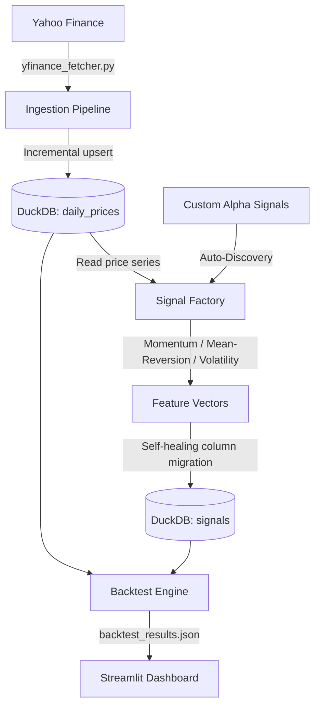

# Quantitative Research Platform Core

A modular daily market-data ingestion, feature-engineering, and vectorized
backtesting engine for S&P 500 equities.

Data is sourced with **yfinance** and stored in **DuckDB**. Signals are
auto-discovered from the `quant_platform/features/` package, persisted to a
feature store with automatic schema migration, and evaluated with **vectorbt**.
A **Streamlit** dashboard presents equity curves, drawdowns, trade logs, and
per-ticker diagnostics.

---

## 🏗️ System Architecture



---

## ⚡ Key Technical Features

1. **Modular sourcing.** All fetchers implement `BaseFetcher`. Adding another
   provider (Alpaca, Polygon, IBKR) means writing one class; nothing in the
   storage or feature layers changes.

2. **Incremental ingestion.** Each symbol resumes from **its own** most recent
   stored session, so a lagging symbol (halt, transient failure) is backfilled
   instead of stranded by the global max date. `--full-refresh` overrides this.
   Downloads are batched per group, with per-symbol retries and exponential
   backoff covering whatever the batch missed.

3. **Extendable Signal Factory.** Drop a module into
   `quant_platform/features/` containing a `BaseSignal` subclass and it is
   discovered automatically — no registration or config.

4. **Self-healing schema migrations.** New signal columns are added to the
   `signals` table with `ALTER TABLE` on the fly.

5. **Column-scoped upserts.** Feature writes update only the columns that were
   actually computed, so a signal that fails for one symbol cannot null out
   that symbol's previously valid values.

6. **Bias-aware backtesting.** Signals are evaluated on a bar's close and
   filled on the **next** bar, so a strategy cannot trade on information it
   would not have had. Configurable via `--execution-delay`.

---

## 🚀 Getting Started

### 1. Installation

```bash
python3 -m venv .venv
source .venv/bin/activate

pip install -r requirements.txt       # runtime
pip install -r requirements-dev.txt   # runtime + test/lint tooling
```

Python 3.11+ is required (Streamlit 1.46+ for the dashboard). Optionally
`pip install -e .` to get the `quant-platform` console script, which is
equivalent to `python -m quant_platform.main`.

### 2. Ingest price data

```bash
# Fast subset (15 representative tickers)
python -m quant_platform.main ingest --test

# Custom list
python -m quant_platform.main ingest --tickers AAPL,MSFT,TSLA,NVDA,SPY --start-date 2023-01-01

# Full S&P 500 (~503 tickers, parsed from Wikipedia)
python -m quant_platform.main ingest --strict-tickers
```

`--strict-tickers` fails loudly if the constituent list cannot be fetched.
Without it, a failed scrape falls back to the 15-ticker default and logs a
warning.

Prices are requested with `auto_adjust=False`, so `adj_close` is a genuine
split/dividend-adjusted series rather than a duplicate of `close` — and it is
the series the signals, backtest fills, and dashboard benchmark all run on,
so a split or dividend never masquerades as a price move.

### 3. Compute features

```bash
python -m quant_platform.main features
```

### 4. Inspect the database

```bash
python -m quant_platform.main status
```

### 5. Run a backtest

```bash
python -m quant_platform.main backtest \
    --strategy rsi \
    --init-cash 10000.0 \
    --fee 0.001 \
    --output data/backtest_results.json
```

Optional window and universe filters avoid loading the full history:

```bash
python -m quant_platform.main backtest --start-date 2024-06-01 --symbols AAPL,MSFT
```

The summary is written to the log, e.g. (sample output — your numbers will
differ):

```
Tear sheet | strategy=RSI_Strategy_30_70 delay=1 bars | initial $10000.00 -> final $13143.84 | return 31.42% (CAGR 10.33%) | max DD 10.57% | Sharpe 1.0185 Sortino 1.3936 | 44 trades, 81.82% win rate
```

`--init-cash` is **total** portfolio capital held in one shared cash book:
any symbol's entry can use capital not yet deployed elsewhere.

### 6. Launch the dashboard

```bash
streamlit run quant_platform/app.py
```

Tabs:

1. **Portfolio Equity Curves** — strategy vs. an equal-weight buy-and-hold
   benchmark over the same universe and capital, plus a drawdown chart.
2. **Trades Auditor** — filterable trade log with win/loss statistics.
3. **Single Ticker Inspector** — price with buy/sell markers and the RSI panel.

The dashboard reads `data/backtest_results.json` rather than re-simulating on
every rerun, and never holds a long-lived database connection.

---

## 🛠️ Adding a Custom Alpha Signal

Create a module under `quant_platform/features/` with a `BaseSignal` subclass:

```python
# quant_platform/features/volatility.py
import pandas as pd

from quant_platform.features.base import BaseSignal


class VolatilitySignal(BaseSignal):
    def __init__(self, window: int = 15):
        self._window = window

    @property
    def name(self) -> str:
        return "volatility_signals"

    @property
    def required_columns(self) -> list[str]:
        return ["close"]

    def compute(self, data: pd.DataFrame) -> pd.DataFrame:
        df = data.sort_values("date").copy()

        result_df = pd.DataFrame({"symbol": df["symbol"], "date": df["date"]})
        rolling_std = df["close"].rolling(window=self._window).std()
        result_df[f"volatility_{self._window}d"] = rolling_std

        return result_df
```

Contract enforced by the factory:

- Return a `DataFrame` containing `symbol` and `date`.
- Return exactly as many rows as the input.
- Do not reuse a column name produced by another signal (the pipeline raises).

The factory then discovers the class, computes it, adds any new column to the
`signals` table, and persists the values.

---

## 📈 Standard Calculated Indicators

| Group | Column | Definition |
|---|---|---|
| Momentum | `macd_line` | EMA(Close, 12) − EMA(Close, 26) |
| Momentum | `macd_signal` | EMA(MACD line, 9) |
| Momentum | `macd_hist` | MACD line − MACD signal |
| Momentum | `roc` | 12-period percent rate of change |
| Momentum | `momentum` | Close / SMA(Close, 10) — a price-to-average ratio |
| Mean Reversion | `rsi` | 14-period RSI with Wilder's smoothing |
| Mean Reversion | `bb_upper` | SMA(20) + 2 × StdDev(20) |
| Mean Reversion | `bb_lower` | SMA(20) − 2 × StdDev(20) |
| Mean Reversion | `bb_percent` | (Close − Lower) / (Upper − Lower) |
| Volatility | `volatility_15d` | 15-day rolling standard deviation of close |
| Volatility | `volatility_ratio_15d` | `volatility_15d` / close |

### Warmup policy

Indicators are **NaN** until their rolling window is full, and those rows are
never used to generate trades:

- RSI is `NULL` for the first 14 bars. The first average gain/loss is the SMA
  of the first 14 deltas, after which Wilder's recursion applies. The result
  matches a reference Wilder implementation exactly.
- Bollinger Bands (`bb_upper`, `bb_lower`, `bb_percent`) are `NULL` for the
  first 19 bars.
- Ratios with a zero denominator (e.g. `roc` after a zero prior close, or a
  zero-width Bollinger band) are `NULL`, never `inf`.

Filling warmup values (for example with RSI = 100) would look like a real
signal and generate trades on indicators that carry no information.

---

## 📐 Performance Metric Definitions

All metrics are computed from the **aggregated portfolio equity curve**, not by
averaging per-symbol statistics.

| Metric | Definition |
|---|---|
| Total Return | `final_value / initial_value − 1` |
| CAGR | `(final / initial)^(1 / years) − 1`, years from elapsed index time (bar count as fallback) |
| Sharpe | `mean(excess daily return) / std(excess daily return) × √252` |
| Sortino | `mean(excess) / sqrt(mean(min(excess, 0)²)) × √252` |
| Max Drawdown | Largest peak-to-trough decline, reported as a positive fraction |
| Win Rate | Fraction of **closed trades** with positive PnL (still-open positions excluded) |

Annualization uses **252 trading days**. VectorBT's `stats()` annualizes a
`"1D"` frequency over 365 calendar days, which overstates Sharpe by roughly
20%; the engine therefore computes these metrics itself. Degenerate curves
(zero volatility with a drift) report an unbounded ratio, exported as `null`.

---

## 🔄 End-to-End Runner

```bash
python quant_platform/run_all.py                 # 15-ticker test universe
python quant_platform/run_all.py --full-universe # full S&P 500
python quant_platform/run_all.py --start-date 2023-01-01
```

Runs ingest → features → backtest in sequence. The runner pins the working
directory and `PYTHONPATH` to the project root, so it works from cron, systemd,
or any other directory. Each stage gets a one-hour timeout so a hung download
cannot wedge a scheduled run.

For scheduling, invoke the runner from your own scheduler, for example:

```cron
30 21 * * 1-5  cd /path/to/Quant-Research-Platform && .venv/bin/python quant_platform/run_all.py >> logs/pipeline.log 2>&1
```

(21:30 UTC on weekdays — after the US close. Adjust to your timezone.)

---

## 🧪 Development

```bash
ruff check quant_platform tests
ruff format --check quant_platform tests
pytest
```

The suite covers signal maths (including RSI parity with a reference Wilder
implementation), the feature-store upsert contract, ingestion incrementality,
backtest look-ahead protection, metric definitions, and the dashboard via
Streamlit's `AppTest`.

### Repository layout

```
quant_platform/
├── config.py            # paths, defaults, logging
├── data_access.py       # shared DuckDB -> aligned matrix loading
├── metrics.py           # portfolio metrics (252-day basis)
├── main.py              # CLI
├── app.py               # Streamlit dashboard
├── run_all.py           # end-to-end runner
├── db/                  # DuckDB connection + schema
├── ingestion/           # BaseFetcher, YFinanceFetcher, IngestionPipeline
├── features/            # BaseSignal, SignalFactory, signal modules
└── backtest/            # BaseStrategy, RSIStrategy, BacktestEngine
tests/
data/                    # local DuckDB + JSON exports (git-ignored)
```

---

## ⚠️ Known Limitations

- **Daily bars only.** Intraday data, corporate-action events, and survivorship
  bias in the S&P 500 constituent list are not modelled.
- **No position sizing or risk model.** Entries consume from the shared cash
  book in vectorbt's default call order; there is no volatility targeting or
  per-name exposure limit.
- **Single strategy family.** Only the RSI mean-reversion strategy is
  implemented; the `BaseStrategy` interface is the extension point.
- **Backtests are in-sample.** There is no walk-forward or out-of-sample
  splitting, so reported metrics describe the fitted period only.
